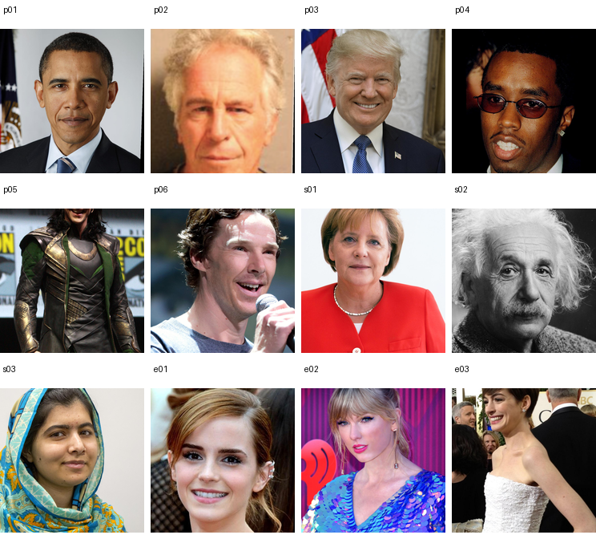
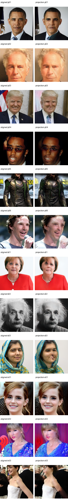
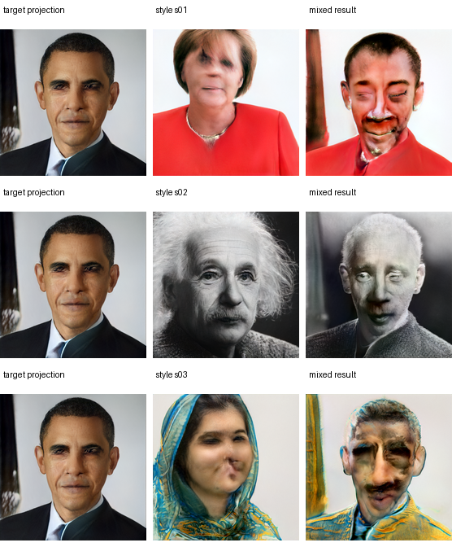
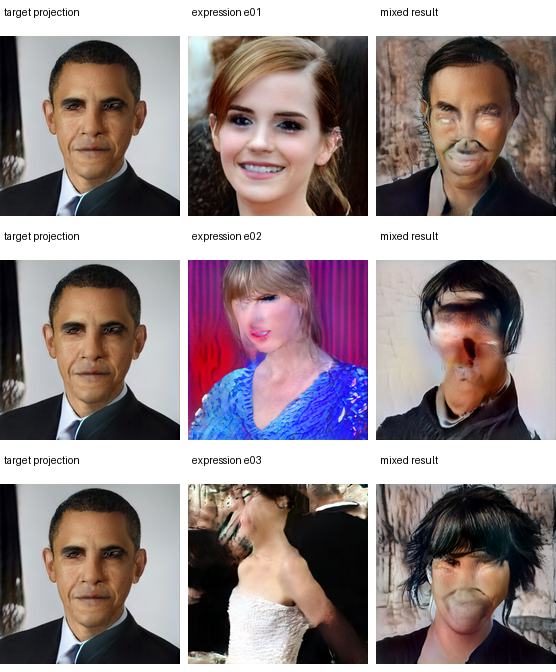
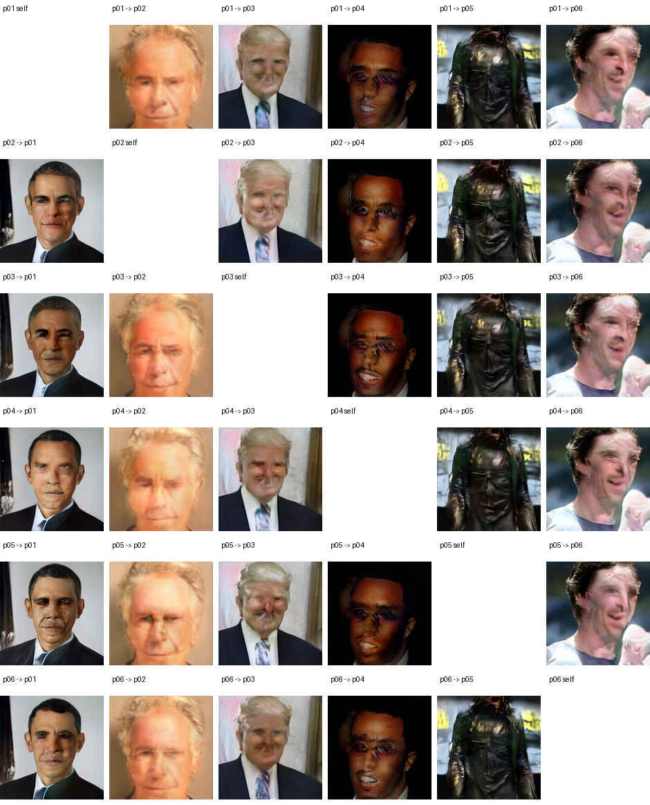

# HW 3. Sampling в латентном пространстве StyleGAN

## Цель

В работе выполнены эксперименты с латентным пространством StyleGAN:

- подготовка и выравнивание портретов;
- проекция изображений в пространство `W+`;
- перенос стиля через смешивание слоев `W+`;
- перенос выражений лица;
- face swap с использованием ArcFace loss;
- оформление результатов в виде итоговых таблиц.

## Датасет

Изображения описаны в `hw_3/image_manifest.json` и скачиваются из Wikimedia Commons. Используются 6 базовых персонажей, 3 изображения для style transfer и 3 изображения для expression transfer. Среди базовых персонажей есть два изображения с поворотом головы не строго в фас: `person_05_tom_hiddleston` и `person_06_benedict_cumberbatch`.

После скачивания изображения сохраняются в `hw_3/data/raw/`. Для выравнивания используются вручную размеченные 5-точечные landmarks из `hw_3/data/landmarks/`. Raw/aligned данные, checkpoints, `vendor/` и промежуточные `.pt` latents не добавляются в git; в репозитории остаются код, manifest, landmarks и финальные PNG-таблицы.

Обозначения в таблицах: `p01-p06` - базовые персонажи, `s01-s03` - изображения стиля, `e01-e03` - изображения выражений.

## Воспроизведение

Зависимости устанавливаются через `uv`:

```bash
uv sync
```

Для StyleGAN checkpoint нужен код NVIDIA `stylegan2-ada-pytorch`, так как checkpoint содержит ссылки на модули `torch_utils`, `dnnlib` и `training`:

```bash
mkdir -p hw_3/vendor
git clone --depth 1 https://github.com/NVlabs/stylegan2-ada-pytorch.git hw_3/vendor/stylegan2-ada-pytorch

mkdir -p hw_3/checkpoints
curl -L https://nvlabs-fi-cdn.nvidia.com/stylegan2-ada-pytorch/pretrained/ffhq.pkl \
  -o hw_3/checkpoints/stylegan2.pkl
curl -L https://huggingface.co/camenduru/show/resolve/main/models/arcface/ms1mv3_arcface_r100_fp16.pth \
  -o hw_3/checkpoints/arcface.pth
```

Полный pipeline запускается одной командой:

```bash
uv run python -m hw_3.scripts.run_full_pipeline \
  --stylegan-checkpoint hw_3/checkpoints/stylegan2.pkl \
  --arcface-checkpoint hw_3/checkpoints/arcface.pth \
  --device mps \
  --projection-steps 1000 \
  --face-swap-steps 300
```

На Linux GPU можно заменить `--device mps` на `--device cuda`.

## Метод

Alignment выполняется по пяти точкам лица. Используется similarity transform: поворот, масштабирование и сдвиг без анизотропного растяжения. Это сохраняет пропорции лица перед проекцией в StyleGAN.

Проекция выполняется в `W+` с адаптацией официального NVIDIA projector: VGG perceptual loss, learning-rate schedule и noise regularization. В отличие от базового `projector.py`, оптимизируется полный `W+` tensor по слоям.

Для style transfer смешиваются поздние слои `7-17`, которые сильнее отвечают за цвет, освещение и текстуру. Для expression transfer используются слои `4-6`, так как они заметнее влияют на локальную геометрию лица. Для face swap оптимизируется копия целевого `W+` по ArcFace loss, при этом меняются только слои `4-10`, чтобы лучше сохранить позу и общий вид target-изображения.

## Результаты обучения и выполнения

Финальные таблицы сохраняются в `hw_3/artifacts/final/`.

В этой работе не обучалась новая GAN-модель: использовались pretrained StyleGAN2 и ArcFace, а оптимизировались latent vectors в `W+`. Поэтому график loss-функции обучения модели и график validation-метрик не применимы к заданию. Вместо них результат оценивается по качеству projection, style transfer, expression transfer и face swap.

### Alignment



### Projection



### Style Transfer



### Expression Transfer



### Face Swap



Значения метрик: отдельные supervised validation-метрики не использовались. Для projection применялся VGG perceptual loss как оптимизационная функция, для face swap - ArcFace identity loss и latent preservation loss. Итоговые артефакты представлены в таблицах выше.

## Эксперименты

Цель эксперимента - проверить, какие операции можно выполнять в latent space StyleGAN после проекции реальных изображений.

Идея эксперимента - использовать одну и ту же базовую проекцию и менять только способ работы с `W+`: поздние слои для style transfer, средние слои для expression transfer и ограниченную оптимизацию слоев `4-10` для face swap.

Результаты экспериментов:

| Эксперимент | Baseline | Результат | Вывод |
| :--- | :--- | :--- | :--- |
| Projection | aligned input | `W+`-реконструкции сохраняют основные черты, но хуже работают на сложных позах и аксессуарах | качество projection ограничивает все следующие этапы |
| Style transfer | target projection без смешивания | переносит цвет, освещение и текстуру source-изображения | поздние слои подходят для общего визуального стиля |
| Expression transfer | target projection без смешивания | частично меняет локальную геометрию и мимику | результат зависит от качества source projection |
| Face swap | target projection без ArcFace-оптимизации | identity source переносится частично, остаются сглаживание и артефакты | простой `W+` optimization не заменяет специализированный face-swap pipeline |

## Выводы

Проекции в `W+` в целом сохраняют основные признаки входных портретов, но сложные изображения с необычной мимикой, очками, сильным освещением или заметным поворотом головы реконструируются хуже. Это также влияет на последующие переносы, так как style transfer, expression transfer и face swap используют уже найденные latent vectors.

Style transfer наиболее заметно переносит цвет, освещение и общую текстуру изображения. Expression transfer меняет локальную геометрию лица, но результат зависит от качества проекции источника выражения.

Face swap через простую оптимизацию `W+` с ArcFace loss оказался самым нестабильным этапом. Метод может частично приблизить identity source, но без маски лица, 3D-геометрии и специализированной face-swap модели часто появляются сглаживание и артефакты. Поэтому результаты этого блока рассматриваются как демонстрация ограничения подхода, а не как полноценный production-quality face swap.

## Проверка

Легкая проверка кода:

```bash
uv run pytest tests/hw_3 -q
```
