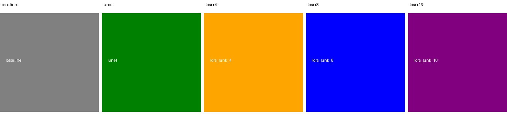

# HW 4. Обучение Stable Diffusion 1.5 методом DreamBooth

## Задание

В этой работе готовится scripts-first пайплайн для обучения персонализированной модели Stable Diffusion 1.5:

- собрать датасет из 15+ изображений одного публичного персонажа;
- обучить DreamBooth full UNet;
- обучить LoRA-модели и сравнить несколько значений `rank`;
- сравнить лучший full UNet checkpoint и лучшую LoRA;
- добавить генерацию с ControlNet;
- оформить результаты обучения и экспериментов в отчете.

## Датасет

В качестве публичного персонажа выбран Barack Obama. Список изображений, источники, подписи и crop boxes описаны в `hw_4/manifests/subject_images.json`.

Подготовка изображений:

```bash
uv run python -m hw_4.scripts.prepare_dataset \
  --manifest hw_4/manifests/subject_images.json \
  --output-dir hw_4/data/processed \
  --image-size 512
```

Скрипт скачивает изображения, приводит их к `RGB`, вырезает область лица по `crop_box`, ресайзит до `512 x 512` и сохраняет `.txt` caption рядом с каждым изображением.

## Воспроизведение

Зависимости устанавливаются через `uv`:

```bash
uv sync
```

Для обучения нужны CUDA GPU и локальный checkout `diffusers` с examples:

```bash
mkdir -p hw_4/vendor
git clone --depth 1 https://github.com/huggingface/diffusers.git hw_4/vendor/diffusers
```

Class images:

```bash
uv run python -m hw_4.scripts.generate_class_images \
  --config hw_4/configs/hw4.json \
  --output-dir hw_4/data/class \
  --count 100 \
  --device cuda
```

Full UNet DreamBooth:

```bash
uv run python -m hw_4.scripts.train_dreambooth_unet \
  --config hw_4/configs/hw4.json \
  --diffusers-dir hw_4/vendor/diffusers \
  --instance-dir hw_4/data/processed/instance \
  --class-dir hw_4/data/class \
  --output-dir hw_4/artifacts/unet \
  --train-steps 800
```

LoRA rank experiments:

```bash
for rank in 4 8 16; do
  uv run python -m hw_4.scripts.train_lora \
    --config hw_4/configs/hw4.json \
    --diffusers-dir hw_4/vendor/diffusers \
    --rank "$rank" \
    --train-steps 800
done
```

Inference для сравнения:

```bash
uv run python -m hw_4.scripts.run_inference \
  --config hw_4/configs/hw4.json \
  --model hw_4/artifacts/unet \
  --output-dir hw_4/artifacts/samples/unet
```

ControlNet:

```bash
uv run python -m hw_4.scripts.run_controlnet \
  --config hw_4/configs/hw4.json \
  --model hw_4/artifacts/unet \
  --control-image hw_4/data/processed/instance/obama_01.jpg \
  --output-dir hw_4/artifacts/controlnet/unet
```

## Результаты обучения

Финальные легкие артефакты должны быть сохранены в `hw_4/artifacts/final/`.

В репозитории приложены smoke-артефакты, которые проверяют формат упаковки отчета до тяжелого CUDA-запуска:



Сопроводительные файлы:

- `artifacts/final/metrics_summary.json`;
- `artifacts/final/report_artifacts.md`;
- `artifacts/final/run.log`.

После полного CUDA-запуска в отчет добавляются:

- график loss-функции для full UNet и LoRA;
- `run.log` для каждого обучения;
- 5 fixed-seed генераций по одинаковым prompt;
- значения итоговых метрик и параметры лучшего запуска.

Validation split отдельно не используется: для DreamBooth качество оценивается по fixed prompt generations, сравнению с baseline SD1.5 и проверке сохранения разнообразия сцен.

## Эксперименты

Цель эксперимента - научить SD1.5 генерировать выбранного персонажа и сравнить способы персонализации.

Идея эксперимента - при одинаковых prompt, seed и batch settings сравнить:

| Эксперимент | Baseline | Что сравнивается |
| :--- | :--- | :--- |
| Full UNet | SD1.5 без обучения | Насколько хорошо DreamBooth переносит identity |
| LoRA rank | LoRA rank 4 | `rank=4`, `rank=8`, `rank=16` по качеству и стабильности |
| UNet vs LoRA | Лучший full UNet | Качество, размер артефактов и удобство использования |
| ControlNet | Генерация без control image | Сохранение структуры при Canny ControlNet |

## Проверка

Локальная проверка без тяжелого обучения:

```bash
uv run pytest tests/hw_4 -q
uv run python -m compileall hw_4
```
